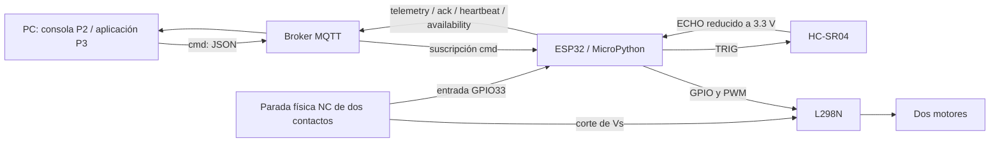
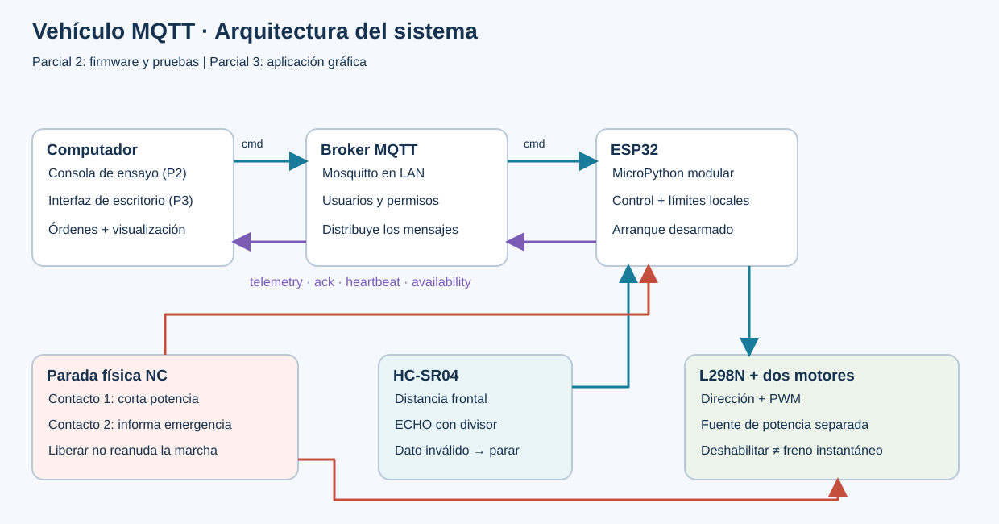
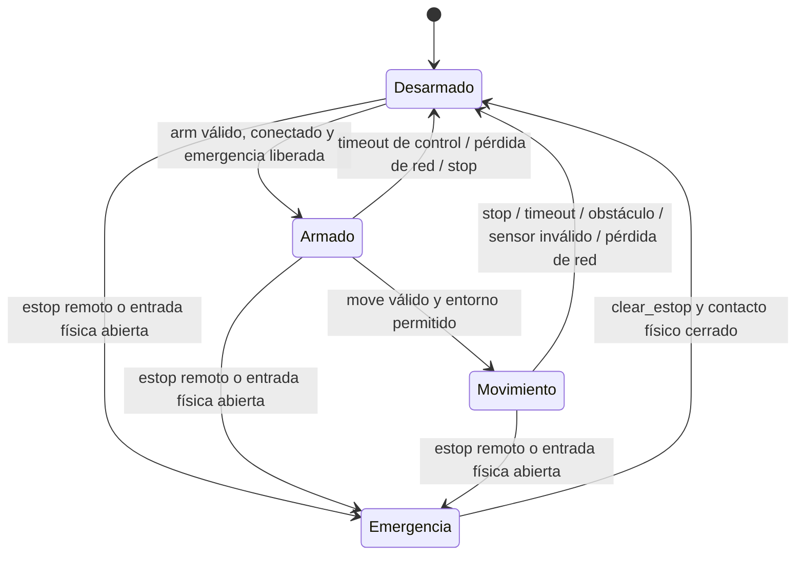
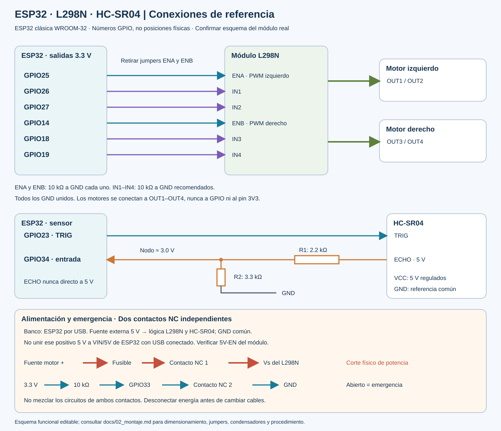

# Parcial 2 · Vehículo móvil con ESP32 y MQTT

Guía integral de Programación II. Preparada el 29 de octubre de 2026.

**Entrega:** firmware modular, montaje de referencia, entorno de desarrollo,
contrato MQTT, pruebas, simulación preparada y diseño de continuidad al Parcial 3.

**Alcance de validación:** consultar el registro incluido. La verificación en PC
no constituye una prueba física ni una ejecución confirmada en Wokwi.

**Fuentes editables:** las secciones originales están en `docs/`, `broker/`,
`simulation/` y `evidence/`. Este documento se regenera con `tools/build_guide.py`.

# 1. Alcance, objetivos y arquitectura

## Objetivo general

Desarrollar un firmware modular en MicroPython para controlar un vehículo diferencial con ESP32 mediante MQTT, adquirir distancia frontal y aplicar condiciones de detención ante obstáculos, pérdida de órdenes y emergencia.

## Objetivos específicos medibles

| Objetivo | Meta y evidencia |
|---|---|
| Adquirir distancia | Una adquisición cada 100 ms; publicar a 2 Hz distancia o `null` con estado de validez; contrastar 10, 20, 50 y 100 cm con regla |
| Controlar actuadores | Demostrar avance, retroceso, giro izquierdo/derecho y detención; PWM de 0 a 100 % con límite inicial de 60 % |
| Intercambiar datos | Recibir JSON válido por MQTT y publicar telemetría, confirmaciones, disponibilidad y heartbeat |
| Evitar marcha sin órdenes actuales | Invalidar la autorización de marcha a los 600 ms sin un nuevo comando de movimiento; verificar latencia real |
| Gestionar fallos | Reconectar con espera creciente hasta 10 s, siempre detenido; exigir nuevo armado tras reconexión |
| Proteger la operación | Parar y bloquear ante emergencia; no reanudar automáticamente al retirar un obstáculo o restaurar la red |
| Documentar desarrollo | Módulos, README, evidencias, historial real de commits y enlace Wokwi si se usa como evidencia final |

Las cifras de tiempo son parámetros de diseño, no mediciones ya obtenidas. El ciclo contiene una medición ultrasónica acotada y operaciones de red no bloqueantes durante la marcha. El corte físico de alimentación de motores es independiente del programa.

## Flujo de datos





## Responsabilidad de los módulos

| Módulo | Responsabilidad |
|---|---|
| `config.py` | Parámetros comunes y valores seguros por defecto |
| `config_local.py` | Credenciales privadas y ajustes del montaje; excluido de Git |
| `motor.py` | Dos puentes, PWM y paso por salida deshabilitada al cambiar sentido |
| `ultrasonic.py` | Disparo de 10 µs, lectura acotada y detección de medida inválida |
| `control.py` | Máquina de estados, validación estricta, secuencias, sesión y límites temporales |
| `mqtt_wire.py` | Subconjunto MQTT 3.1.1 QoS 0 con búferes y tiempos limitados |
| `wifi.py` | Conexión Wi-Fi mientras los motores permanecen apagados |
| `app.py` | Coordina lectura, decisiones, comunicación, reconexión y watchdog |
| `main.py` / `boot.py` | Punto de entrada y estado eléctrico de arranque |

## Máquina de estados



La reconexión no arma. El heartbeat de la aplicación mantiene su presencia, pero **no prolonga un movimiento**: cada movimiento exige renovación cada 200 ms. El sensor frontal se usa como autorización para cualquier movimiento de esta versión, incluidos giros y retroceso. Es una decisión conservadora: un obstáculo frontal obliga a retirar el vehículo manualmente. No existe detección de obstáculos traseros o laterales.

## Plan de trabajo del estudiante

1. Revisar el montaje y confirmar modelos y corrientes.
2. Comprobar alimentación y sensor por separado.
3. Verificar un motor y luego ambos con ruedas elevadas.
4. Configurar red y demostrar mensajes de estado.
5. Probar el control y todos los modos de parada.
6. Registrar resultados, fallos, correcciones y commits por cada etapa real.
7. Presentar demostración y conservar el contrato para la aplicación del Parcial 3.


---

# 2. Materiales, pinout y montaje seguro

## 2.1 Supuestos que deben verificarse

Se diseña para una **ESP32 DevKit con ESP32-WROOM-32 clásica**, dos motores DC con reductora y módulo comercial L298N con diodos de recirculación y disipador. Confirmar la serigrafía y el esquema de la placa adquirida. Los números son **GPIO**, no posiciones físicas del conector. No trasladar este pinout a una C3/S3 ni a un módulo WROOM desnudo.

## 2.2 Lista de materiales

| Cantidad | Elemento | Selección y función |
|---|---|---|
| 1 | ESP32 DevKit WROOM-32 y cable USB de datos | Alimentación USB y programación inicial |
| 1 | L298N con disipador y diodos | Dos canales; verificar esquema, polaridad y corriente |
| 2 | Motores DC con reductora | Anotar tensión nominal y corriente de bloqueo de cada motor |
| 1 | Chasis, dos ruedas y rueda libre | Asegurar motores y separar cables del giro |
| 1 | HC-SR04 | 5 V; ECHO no se conecta directamente a ESP32 |
| 1 + 1 | Resistencias 2.2 kΩ y 3.3 kΩ, 1 % | Divisor de ECHO a aproximadamente 3.0 V |
| 2 | Resistencias 10 kΩ | ENA y ENB a GND; arranque deshabilitado |
| 4 | Resistencias 10 kΩ recomendadas | IN1–IN4 a GND para estados definidos |
| 1 | Resistencia 10 kΩ | GPIO33 a 3.3 V; contacto NC a GND |
| 1 | Parada de emergencia con dos contactos NC independientes | Un contacto corta Vs; el otro informa a GPIO33 |
| 1 | Fusible y portafusible | Calibre según corriente medida, arranque y capacidad del cable |
| 1 | Fuente de motores regulada o batería protegida | Tensión y corriente determinadas por motores y pérdidas |
| 1 | Fuente regulada de 5 V para lógica | Capacidad y polaridad verificadas antes de conectar |
| 1 | Condensador 470–1000 µF de tensión adecuada | Cerca de Vs/GND del L298N, respetando polaridad |
| 2 | Condensadores cerámicos 100 nF | Uno entre terminales de cada motor, cerca de sus bornes |
| Varios | Cable, borneras, multímetro y soporte de pruebas | El recorrido de potencia no debe usar protoboard ni cables finos |

No se fija un precio ni un fusible universal porque faltan los modelos reales. No seleccionar fuente a partir de la corriente en vacío solamente. El interruptor debe soportar **corriente continua** e irrupción de los motores; si no, usar un dispositivo de corte adecuado controlado por él.

## 2.3 Pinout obligatorio

| ESP32 | Destino | Tipo y condición |
|---|---|---|
| GPIO25 | L298N ENA | PWM motor izquierdo; retirar jumper ENA; 10 kΩ a GND |
| GPIO26 | L298N IN1 | Dirección izquierda |
| GPIO27 | L298N IN2 | Dirección izquierda |
| GPIO14 | L298N ENB | PWM motor derecho; retirar jumper ENB; 10 kΩ a GND |
| GPIO18 | L298N IN3 | Dirección derecha |
| GPIO19 | L298N IN4 | Dirección derecha |
| GPIO23 | HC-SR04 TRIG | Pulso de salida 3.3 V; verificar aceptación del módulo real |
| GPIO34 | Nodo del divisor ECHO | Solo entrada; sin pull-up interno disponible |
| GPIO33 | Contacto auxiliar NC a GND | Pull-up externo de 10 kΩ a 3.3 V; abierto = emergencia |
| GND | GND L298N, sensor y fuentes | Referencia común; recorrido de corriente de motor separado |
| — | L298N OUT1/OUT2 | Terminales del motor izquierdo |
| — | L298N OUT3/OUT4 | Terminales del motor derecho |

Los pines de arranque GPIO0/2/5/12/15, la memoria GPIO6–11 y la UART USB GPIO1/3 se dejan libres. GPIO34 es apto como entrada y no tiene resistencias internas; el divisor también establece su nivel bajo. [Referencia de GPIO de Espressif](https://docs.espressif.com/projects/esp-idf/en/stable/esp32/api-reference/peripherals/gpio.html).

## 2.4 Divisor para ECHO

```text
HC-SR04 ECHO (5 V) ── R1 2.2 kΩ ──┬── GPIO34
                                 │
                              R2 3.3 kΩ
                                 │
                                GND
```

`V_GPIO = V_ECHO × R2 / (R1 + R2) = 5 × 3.3 / 5.5 = 3.0 V`.

A 5.25 V y con resistencias de 1 % en el peor sentido, el nodo es aproximadamente 3.18 V. Confirmar el valor de ambas resistencias y medir antes de conectar a GPIO34; un multímetro puede no capturar el pico de pulsos cortos, por lo que se recomienda osciloscopio para ECHO real. No aceptar 5 V en un GPIO: las características eléctricas del ESP32 corresponden a lógica de 3.3 V. [Hoja de datos ESP32](https://www.espressif.com/sites/default/files/documentation/esp32_datasheet_en.pdf).

TRIG de 3.3 V suele ser reconocido por módulos HC-SR04 TTL; si el módulo concreto no lo reconoce, incorporar un traductor unidireccional compatible, por ejemplo una puerta de familia AHCT alimentada a 5 V, según su ficha. No elevar la salida ESP32 a 5 V mediante una resistencia pull-up.

## 2.5 Alimentación: elegir una sola ruta por placa

**Montaje de banco recomendado:**

1. ESP32 alimentada por USB del computador.
2. Fuente regulada independiente de 5 V alimenta HC-SR04 y la lógica del L298N.
3. Fuente de motores alimenta únicamente `Vs` (a veces rotulado `12V`) del L298N, pasando por fusible y contacto NC de potencia.
4. Unir todos los GND en una referencia común. El retorno de motores va directo a la fuente, evitando circular por la ESP32 o la protoboard.
5. No unir el positivo de esa fuente de 5 V al pin 5V/VIN de la ESP32 mientras esta recibe USB.

**Módulo L298N:** retirar los jumpers ENA/ENB para PWM. El jumper llamado habitualmente `5V-EN` corresponde a su regulador y es diferente. Para el esquema de lógica externa de 5 V, retirarlo **solo después de confirmar que el borne 5V pasa a ser entrada en ese modelo**. Algunas placas difieren: consultar el esquema o comprobar continuidad sin energía. Nunca conectar dos reguladores enfrentados.

**Montaje autónomo:** una batería protegida puede alimentar Vs y un convertidor de 5 V; conectar este último a una entrada documentada de la placa ESP32, sin USB simultáneo salvo que el fabricante garantice aislamiento. No se proporciona un conexionado universal de VIN porque las DevKit comerciales difieren. Primero completar la validación de banco.

## 2.6 Compatibilidad y pérdidas del L298N

El L298 acepta un nivel alto desde 2.3 V, por lo que una señal ESP32 de 3.3 V puede controlar sus entradas. Necesita alimentación lógica apropiada de 5 V. Tiene una caída importante en sus transistores: la tensión efectiva del motor resulta menor que Vs y depende de la corriente. Las especificaciones de corriente del integrado no equivalen a capacidad continua garantizada del módulo. [Ficha L298, tablas eléctricas](https://www.st.com/resource/en/datasheet/l298.pdf).

No compensar la caída aplicando una tensión arbitrariamente alta: durante PWM el motor recibe pulsos de tensión, y la caída no es constante. Para motores nominales de 6 V, comenzar con fuente limitada de hasta 6 V para el ensayo y aceptar la pérdida de rendimiento; si no basta, revisar el dimensionamiento o usar otro puente eficiente. Medir corriente con instrumento en **serie**, nunca cortocircuitar la fuente poniendo un amperímetro entre sus bornes.

Calcular la disipación a partir de la corriente y caída observadas. Como ejemplo conceptual, 1 A con caída de 2 V representa 2 W por canal. Si aparecen reinicios, calentamiento excesivo o caída fuerte de Vs, detener y revisar fuente, cableado y motor. Un fusible protege principalmente cableado y cortocircuitos; no garantiza salvar el puente frente a toda sobrecarga.

## 2.7 Parada física

```text
Fuente motor + ── fusible ── contacto NC de potencia ── Vs L298N
3.3 V ── 10 kΩ ── GPIO33 ── contacto NC auxiliar ── GND
```

Los contactos están mecánicamente vinculados y eléctricamente separados. Al pulsar se abren ambos: se retira energía de los motores y GPIO33 pasa a alto. **No llevar tensión de motor al contacto conectado a GPIO33.** Un cable auxiliar cortado también produce emergencia. Al liberar el pulsador, el programa sigue bloqueado hasta `clear_estop` y después `arm`. La orden remota `estop` es una medida de software; no sustituye el corte físico.

La parada por EN bajo es una **deshabilitación con posible avance por inercia**, no una garantía de frenado instantáneo. El umbral de 20 cm debe ajustarse a velocidad, superficie y distancia de detención medida. El prototipo no es un sistema de seguridad certificado.

## 2.8 Secuencia de montaje y mediciones

1. Con todas las fuentes desconectadas, identificar placa, contactos, jumpers y polaridades. Dibujar el esquema real si difiere del propuesto.
2. Conectar GND y divisor; medir resistencias y descartar cortocircuito entre positivos y GND.
3. Alimentar la lógica sin motores y medir 5 V y 3.3 V. Apagar antes de cambiar cables.
4. Verificar el sensor y el nivel máximo de ECHO. Mostrar `distance_cm` y `sensor_ok`.
5. Conectar EN y dirección, comprobar que ENA/ENB permanecen bajos en arranque, reinicio y ausencia de programa.
6. Cablear corte físico de Vs y auxiliar; comprobar continuidad y apertura sin alimentación.
7. Conectar un motor, ruedas suspendidas y fuente limitada. Confirmar sentido a baja potencia; después probar el segundo.
8. Si un lado gira invertido, apagar e intercambiar sus terminales o ajustar `INVERT_LEFT/RIGHT`. No cambiar al azar la tabla de direcciones.
9. Medir consumo de arranque y marcha; registrar Vs bajo carga y temperatura del controlador con método apropiado.
10. Ejecutar pérdidas de conexión, timeout, emergencia y obstáculos antes de probar sobre el suelo.




---

# 3. Entorno Windows, PyCharm, MicroPython y GitHub

## 3.1 Estado encontrado en este equipo

El 29 de octubre de 2026 se detectaron Git 2.45.1, PyCharm 2026.2.2 y Python 3.14.7 instalado en `C:\Users\em435\AppData\Local\Programs\Python\Python314\python.exe`. El comando `python` del sistema apunta a otra instalación (MSYS2 3.12.12), mientras que `py -0p` no detectó intérpretes. Para evitar ambigüedad se creó `.venv` con el ejecutable explícito de Python 3.14.7.

Se conservó la identidad Git que ya estaba configurada; no se cambió la configuración global ni se inventó una cuenta. PyCharm ya existe: no fue necesario reinstalarlo. Se incluye una configuración de ejecución en `.run/`; falta abrirla en la interfaz y confirmar su selección de intérprete.

## 3.2 Instalación en otro computador

1. Descargar Git desde [Git para Windows](https://git-scm.com/install/windows). Conservar Git Credential Manager y la integración con la terminal. Verificar `git --version`.
2. Instalar Python desde [Python para Windows](https://www.python.org/downloads/windows/). Seleccionar una versión compatible con las dependencias y anotar la ruta al ejecutable.
3. Instalar PyCharm desde [JetBrains](https://www.jetbrains.com/help/pycharm/installation-guide.html). La edición unificada conserva funciones esenciales gratuitas; este proyecto no necesita funciones Pro.
4. Instalar Mosquitto únicamente si se usará broker local; seguir `broker/README.md`.

Desde PowerShell, ubicarse en la carpeta del proyecto. En el equipo actual:

```powershell
Set-Location 'C:\Users\em435\OneDrive\Documentos\ChatGPT\MQTT Proyecto'
& 'C:\Users\em435\AppData\Local\Programs\Python\Python314\python.exe' -m venv .venv
& '.\.venv\Scripts\python.exe' -m pip install -r requirements-dev.txt
& '.\.venv\Scripts\python.exe' -m unittest discover -s tests -v
& '.\.venv\Scripts\python.exe' tools/check_project.py
```

El entorno ya creado no necesita recrearse. En otro computador, sustituir la primera ruta Python. No es necesario activar PowerShell ni cambiar su política de ejecución para usar directamente `.venv\Scripts\python.exe`.

`requirements-dev.txt` describe rangos admitidos; `requirements-lock.txt` registra las versiones instaladas en esta sesión. El entorno PC ejecuta herramientas y pruebas. El firmware se ejecuta en **MicroPython dentro de la ESP32**, con sus módulos `machine` y `network`.

## 3.3 Configuración de PyCharm

1. **File → Open**: abrir la carpeta `MQTT Proyecto` completa.
2. **Settings → Python → Interpreter → Add Local Interpreter**: seleccionar el entorno existente `.venv\Scripts\python.exe`.
3. **Settings → Version Control → Git**: verificar `C:\Program Files\Git\cmd\git.exe` y pulsar Test.
4. En configuraciones de ejecución, seleccionar **Pruebas del proyecto**. Si la configuración compartida no aparece por diferencias de versión, crear una configuración Python con módulo `unittest`, parámetros `discover -s tests -v` y directorio de trabajo la raíz.
5. Ejecutar las pruebas. Para la consola, crear otra configuración con script `tools/console.py` y parámetros `--host IP_DEL_BROKER --base prog2/equipo01/carro01`.
6. Crear `firmware/config_local.py` copiando el ejemplo. El archivo se excluye de Git.

PyCharm es editor y entorno de herramientas PC. No pulsar Run sobre `firmware/main.py`: Python del computador no controla los GPIO. No se depende de un complemento MicroPython de PyCharm; la transferencia se hace con la herramienta oficial `mpremote`. [Intérpretes de PyCharm](https://www.jetbrains.com/help/pycharm/creating-virtual-environment.html), [mpremote](https://docs.micropython.org/en/latest/reference/mpremote.html).

## 3.4 Instalar MicroPython en la ESP32

**Alimentación de motores físicamente desconectada durante borrado y programación.** Identificar el puerto COM en el Administrador de dispositivos o mediante:

```powershell
& '.\.venv\Scripts\python.exe' -m serial.tools.list_ports
```

Descargar una versión estable desde [ESP32_GENERIC para WROOM](https://micropython.org/download/ESP32_GENERIC/). Guardar el nombre exacto y la versión utilizada en la evidencia. No usar firmware C3/S3 para ESP32 clásica.

Ejemplo para **ESP32 clásica** y esptool 5; cambiar `COM5` y el nombre del archivo. El primer comando borra todos los archivos existentes en esa placa:

```powershell
& '.\.venv\Scripts\python.exe' -m esptool --chip esp32 --port COM5 erase-flash
& '.\.venv\Scripts\python.exe' -m esptool --chip esp32 --port COM5 --baud 460800 write-flash 0x1000 '.\ESP32_GENERIC-VERSION.bin'
```

El desplazamiento corresponde a la placa clásica y debe confirmarse en la página de descarga del archivo concreto. Si no conecta, cerrar otras consolas serie, verificar cable de datos, bajar baud a 115200 y seguir el procedimiento BOOT/EN de la placa. No cambiar pines de arranque al azar.

## 3.5 Configurar Wi-Fi y cargar archivos

```powershell
Copy-Item -LiteralPath '.\firmware\config_local.example.py' -Destination '.\firmware\config_local.py'
```

Editar los siguientes valores:

| Valor | Contenido |
|---|---|
| `WIFI_SSID`, `WIFI_PASSWORD` | Red 2.4 GHz y contraseña |
| `MQTT_HOST` | IPv4 LAN del computador con Mosquitto |
| `MQTT_PORT` | 1883 en la red de laboratorio |
| `MQTT_USER`, `MQTT_PASSWORD` | Usuario `carro` y contraseña del broker |
| `TOPIC_ROOT`, `DEVICE_ID` | Coincidir exactamente con ACL y cliente |

En ESP32, `localhost` sería la propia ESP32. Wi-Fi de invitado o aislamiento entre clientes puede impedir conexión al PC aunque ambos tengan Internet.

Con motores desconectados, ejecutar desde PowerShell:

```powershell
.\tools\upload.ps1 -Port COM5
& '.\.venv\Scripts\python.exe' -m mpremote connect COM5 reset
& '.\.venv\Scripts\python.exe' -m mpremote connect COM5 repl
```

Si la política local impide ejecutar scripts PowerShell, copiar manualmente cada módulo con `mpremote connect COM5 fs cp RUTA :NOMBRE.py`, incluido `config_local.py`, y copiar `main.py` al final. No cambiar políticas globales para solucionar este paso.

No ejecutar la carga si ya existe código ajeno que deba preservarse: respaldar antes con `mpremote fs cp`. Esta entrega no ha borrado ni programado una placa.

Al reiniciar debe verse conexión Wi-Fi/MQTT o un mensaje de reintento, nunca un movimiento espontáneo. El WDT puede reiniciar después de Ctrl+C; para mantenimiento conservar motores sin alimentación.

## 3.6 Uso del cliente de ensayo

En otra terminal, desde la raíz:

```powershell
& '.\.venv\Scripts\python.exe' tools/console.py --host 192.168.1.10 --base prog2/equipo01/carro01 --user operador
```

Introducir la contraseña cuando se solicite. Esperar aproximadamente un segundo y escribir `status`. Una prueba explícita es `move forward 30 2`: arma y solicita avance al 30 % durante 2 s, con renovación periódica, confirmaciones y orden final de parada. El porcentaje es **PWM configurado**, no velocidad medida en m/s. Empezar con ruedas elevadas; un motor puede no arrancar a bajo PWM.

`estop` enclava la emergencia; `clear` la libera solo si el contacto físico está cerrado. Esperar nueva telemetría y dar una nueva orden de movimiento. `stop` y `quit` solicitan detención. Si la conexión desaparece, el timeout de la placa es la defensa principal; una orden de parada por red podría no llegar.

## 3.7 Historial Git y publicación en GitHub

La carpeta contiene un repositorio local en rama `main`. Revisar:

```powershell
git status
git log --oneline --reverse
git config --get user.name
git config --get user.email
```

Para un equipo nuevo sin identidad, establecerla únicamente después de sustituir los ejemplos por datos propios:

```powershell
git config user.name 'TU NOMBRE'
git config user.email 'TU CORREO O CORREO PRIVADO DE GITHUB'
```

1. Iniciar sesión en GitHub y crear un repositorio, por ejemplo `vehiculo-mqtt-parcial2`. Elegir visibilidad y crear vacío, sin README adicional, porque ya existe uno local.
2. Antes de publicar, comprobar `git status`, revisar archivos y verificar que contraseñas y `.venv` no estén incluidos. El historial usa la identidad preexistente; revisar también el correo de autor que se publicará.
3. Copiar la URL HTTPS del repositorio y ejecutar, sustituyendo el marcador:

```powershell
git remote add origin https://github.com/TU_USUARIO/vehiculo-mqtt-parcial2.git
git push -u origin main
```

Si `origin` ya existe, consultar `git remote -v` y verificarlo antes de cambiarlo. Git Credential Manager puede abrir el acceso de GitHub; no escribir contraseñas ni tokens en el código o en la URL. Si hay cambios remotos, integrarlos conscientemente; no usar `push --force` para resolverlo automáticamente. [Guía oficial de publicación](https://docs.github.com/en/migrations/importing-source-code/using-the-command-line-to-import-source-code/adding-locally-hosted-code-to-github).

4. Abrir el repositorio, comprobar carpetas e historial y añadir URL del repo y de Wokwi (si procede) al registro de entrega.
5. Continuar con commits reales: `test: registrar mediciones del HC-SR04`, `fix: corregir inversion del motor derecho`, `test: medir parada por timeout`, según lo que efectivamente ocurra. No crear commits vacíos ni cambiar fechas para simular semanas de trabajo.

Ejemplo tras una prueba real:

```powershell
git add evidence/PRUEBAS_FISICAS.md
git commit -m 'test: registrar mediciones reales de distancia y parada'
git push
```

No se publicó un repositorio remoto en esta sesión: falta la URL elegida y el acceso de la cuenta. Los commits locales corresponden a etapas reales de esta preparación, no a evidencia histórica de trabajo anterior.


---

# Broker Mosquitto para el laboratorio

El firmware usa MQTT 3.1.1 por TCP, puerto 1883, con usuario/contraseña. **No implementa TLS**. Usar red local de laboratorio confiable y sin redirección de puertos desde Internet; las credenciales de 1883 no viajan cifradas. Un broker público se reserva para simulación sin motores físicos ni datos privados.

1. Instalar [Mosquitto para Windows](https://mosquitto.org/download/). Si el instalador crea un servicio, comprobar si ya ocupa el puerto antes de arrancar otra instancia.
2. Desde la raíz del proyecto copiar:

```powershell
Copy-Item '.\broker\mosquitto.example.conf' '.\broker\mosquitto.local.conf'
Copy-Item '.\broker\acl.example' '.\broker\acl.local'
```

3. Para ensayos solo en PC dejar `listener 1883 127.0.0.1`. Para ESP32, usar `ipconfig`, identificar la IPv4 de la interfaz Wi-Fi y sustituir `127.0.0.1` por esa IP, por ejemplo `192.168.1.10`. La ESP32 y la consola deberán conectarse a la misma IP. Si la IP cambia por DHCP, actualizar la configuración o reservarla en el router.
4. Crear dos usuarios, con contraseñas diferentes introducidas interactivamente:

```powershell
& 'C:\Program Files\mosquitto\mosquitto_passwd.exe' -c '.\broker\passwords' carro
& 'C:\Program Files\mosquitto\mosquitto_passwd.exe' '.\broker\passwords' operador
```

La opción `-c` crea/sobrescribe el archivo: usarla solo la primera vez. `passwords` y los archivos locales están excluidos de Git.

5. Ajustar las rutas de topics de `acl.local` si se cambia equipo o vehículo. `carro` puede leer comandos y publicar sus estados; `operador` puede emitir comandos y leer esos estados. Mantener los nombres sincronizados con `config_local.py` y `--base`.
6. Arrancar desde la raíz, pues las rutas del archivo son relativas a ese directorio:

```powershell
& 'C:\Program Files\mosquitto\mosquitto.exe' -c '.\broker\mosquitto.local.conf' -v
```

7. Si Windows solicita acceso de red, limitarlo al perfil privado que corresponda. Si hay que crear una regla manual, restringir puerto 1883 a la subred del laboratorio; no desactivar todo el firewall.
8. Iniciar la consola con el usuario operador y esperar telemetría de la placa.

Pruebas de aceptación: credenciales equivocadas deben fallar; el usuario carro no puede publicar en `cmd`; operador no puede falsificar `telemetry`. La configuración está preparada, pero estas comprobaciones requieren ejecutar Mosquitto y se registran como pendientes hasta realizarlas.

El archivo de ejemplo escucha solo en loopback para evitar abrir innecesariamente la red al copiarlo. La persistencia se desactiva en este laboratorio: reiniciar el broker elimina mensajes retenidos almacenados. Esto no reemplaza las protecciones de sesión del firmware.

Fuentes: [configuración oficial de Mosquitto](https://mosquitto.org/man/mosquitto-conf-5.html), [usuarios con mosquitto_passwd](https://mosquitto.org/man/mosquitto_passwd-1.html).


---

# 4. Contrato MQTT, estados y recuperación

## 4.1 Nombres y direcciones

Base predeterminada `prog2/equipo01/carro01`. Cambiar equipo/vehículo de forma coherente en ESP32, broker ACL y cliente. Un identificador de cliente MQTT único evita que dos placas se expulsen; la ESP32 añade su identificador físico al nombre de dispositivo.

| Topic relativo a la base | Publica → recibe | Periodicidad | QoS / retain |
|---|---|---|---|
| `/cmd` | PC → ESP32 | Evento; renovar movimiento cada 200 ms | 0 / false |
| `/ack` | ESP32 → PC | Una respuesta por comando recibido | 0 / false |
| `/telemetry` | ESP32 → PC | Cada 500 ms | 0 / false |
| `/heartbeat` | ESP32 → PC | Cada 1000 ms | 0 / false |
| `/availability` | ESP32/broker → PC | Conexión y última voluntad | 0 / true |

El cliente solicita QoS 0 y `clean session=true`: se descartan órdenes pendientes de sesiones anteriores. QoS 0 puede perder mensajes, por eso hay confirmación de aplicación, renovación de marcha y parada local. No se usa QoS 1 para órdenes, pues este transporte no lo implementa. [Especificación MQTT 3.1.1](https://docs.oasis-open.org/mqtt/mqtt/v3.1.1/os/mqtt-v3.1.1-os.html).

## 4.2 Comandos JSON (versión 1)

`session` se lee en la telemetría actual. Los siguientes son ejemplos; sustituir el texto `SESION_ACTUAL` por el valor real. `seq` es un entero estrictamente creciente dentro de esa sesión; no usar `true`, decimales ni cadenas. Solo debe existir un operador activo por vehículo.

```json
{"v":1,"action":"arm","session":"SESION_ACTUAL","seq":1}
```

```json
{"v":1,"action":"move","session":"SESION_ACTUAL","seq":2,"direction":"forward","speed":30}
```

Direcciones admitidas: `forward`, `backward`, `left`, `right`. El porcentaje válido para movimiento es 1 a `MAX_SPEED` (60 inicialmente); usar `stop` para cero. Cambiar velocidad consiste en emitir un nuevo `move` con nueva secuencia y porcentaje, no en cambiar un valor sin autorización de marcha.

```json
{"v":1,"action":"heartbeat","session":"SESION_ACTUAL","seq":3}
```

Este heartbeat PC → ESP32 mantiene el estado armado en reposo hasta el límite de control, pero no renueva la marcha. La consola de ensayo usa movimientos acotados y no mantiene el armado indefinidamente mientras se escribe.

```json
{"v":1,"action":"stop"}
```

```json
{"v":1,"action":"estop"}
```

Se aceptan `stop` y `estop` sin conocer sesión/secuencia para favorecer la detención. `stop` desarma; `estop` también enclava el bloqueo. Ambas órdenes requieren JSON válido y no retenido. Para liberar el bloqueo:

```json
{"v":1,"action":"clear_estop","session":"SESION_ACTUAL","seq":4}
```

Requiere el contacto NC físico cerrado y solo deja el carro desarmado. Después hay que esperar la nueva sesión, enviar `arm` y una nueva orden `move`. Se rechazan propiedades desconocidas, versiones distintas, secuencias duplicadas y payloads mayores de 384 bytes.

El enclavamiento remoto se mantiene en memoria durante la ejecución. Después de reiniciar, el vehículo arranca desarmado con otra sesión; ese enclavamiento remoto no se conserva en memoria no volátil. El pulsador físico permanece abierto hasta que se libere mecánicamente, y vuelve a detectarse al arrancar.

## 4.3 Respuestas y telemetría

```json
{"v":1,"ok":true,"reason":"move","seq":2,"session":"0123456789abcdef"}
```

La confirmación significa que el firmware aceptó la orden y actualizó las salidas; no demuestra que las ruedas efectivamente giraron. El vehículo no tiene encoders.

```json
{
  "v":1,"session":"0123456789abcdef","seq":2,"uptime_ms":12500,
  "connected":true,"armed":true,"estop":false,"physical_estop":false,
  "direction":"forward","speed_pct":30,"distance_cm":78.4,
  "sensor_ok":true,"reason":"moving","battery_v":null
}
```

`distance_cm=null` indica una adquisición inválida. `sensor_ok` también es falso cuando la lectura tiene al menos 350 ms de antigüedad. `uptime_ms` usa el contador de MicroPython, que puede volver al inicio al reiniciar y dar la vuelta; el PC no debe tratarlo como fecha UTC. Debe guardar además la hora local de recepción y calcular antigüedad con su reloj monotónico.

Heartbeat ESP32 → PC: `{"v":1,"seq":12,"uptime_ms":12500}`. Disponibilidad: `{"v":1,"online":true}` o `false`. La última voluntad se registra al conectar y el broker la emite al detectar una salida inesperada. El keepalive es 10 s y el cliente comprueba PINGRESP; **la voluntad no sustituye el timeout de 600 ms del motor**. Un estado retenido `online=true` tampoco demuestra presencia actual: la interfaz debe revisar telemetría reciente.

## 4.4 Condiciones de parada

| Condición | Acción |
|---|---|
| 600 ms sin nuevo `move` válido | EN=0, desarmar, nueva sesión |
| 1000 ms sin control válido estando armado | Desarmar |
| Distancia ≤20 cm o medida inválida/antigua | Desarmar; no reanudar al despejar |
| Contacto NC abierto | Corte físico de Vs y bloqueo de software |
| `estop` remoto | Deshabilitar y enclavar; depende de que llegue el mensaje |
| Pérdida Wi-Fi/TCP, error de protocolo o cola llena | Detener y reconectar desarmado |
| Excepción no recuperada o Ctrl+C | `finally` deshabilita motores; WDT puede reiniciar |
| Bloqueo del intérprete | WDT de 5 s como respaldo; corte físico disponible |

El plazo de 600 ms es una regla lógica medida desde el último comando aceptado, **no un máximo certificado de detención mecánica**. En operación normal se añade el retraso de ejecución del ciclo y la inercia. `time_pulse_us` puede esperar en dos fases, cada una acotada por 25 ms. Se debe medir la latencia en hardware con ENA/ENB y registrar el resultado. No hay garantía de tiempo real duro en MicroPython.

## 4.5 Reconexión y alcance del transporte

1. Desarmar antes de cualquier DNS, conexión TCP o Wi-Fi.
2. Conectar Wi-Fi con espera limitada y atender la entrada de emergencia mientras se espera.
3. Abrir MQTT, registrar última voluntad y suscribirse; solo aceptar control operativo después de SUBACK.
4. Crear nueva sesión, publicar disponibilidad y telemetría. No recuperar velocidad anterior.
5. Ante error, cerrar socket, detener y esperar 0.5, 1, 2, 4, 8 y hasta 10 s. Restablecer espera corta tras 10 s estables.

`mqtt_wire.py` es un cliente educativo limitado: MQTT 3.1.1, una suscripción QoS 0, usuario/contraseña, voluntad, ping y publicación. Durante marcha usa socket no bloqueante, lectura máxima de 256 bytes por ciclo, hasta cuatro paquetes por ciclo, paquete de hasta 1024 bytes y cola de hasta 4096 bytes. Fragmentos incompletos caducan a los 500 ms y envíos detenidos a los 1000 ms. DNS y conexión se realizan únicamente parado; el watchdog es respaldo si la plataforma se bloquea allí.

La sesión aleatoria y secuencias reducen repetición accidental y órdenes antiguas; **no son autenticación criptográfica**. Rotan en reconexión y desarmado. Las banderas de retención se rechazan al recibirlas; además, la sesión impide reutilizar órdenes retenidas de una conexión anterior. Un broker puede entregar una publicación en vivo con RETAIN desactivado aunque el emisor la haya almacenado; por eso el emisor siempre debe usar `retain=false` y no se confía solamente en esa bandera.

Esta entrega supone un único operador y red local confiable. La evolución a Internet exige TLS con validación de certificados, control de acceso revisado y una implementación compatible; cambiar solamente el puerto a 8883 no activa TLS.


---

# 5. Estrategia de pruebas y criterios de aceptación

## 5.1 Niveles de evidencia

| Nivel | Qué permite concluir | Qué no demuestra |
|---|---|---|
| Análisis de sintaxis | Archivos Python sin errores sintácticos en CPython | Existencia de periféricos o compatibilidad completa con la placa |
| Pruebas automatizadas PC | Reglas de seguridad y transporte ante entradas controladas | Tiempo real, red Wi-Fi real o motores |
| Wokwi | Ejecución MicroPython, sensor y señales digitales simuladas | Tensión, corriente, ruido, temperatura, inercia o protección analógica |
| Ensayo físico | Comportamiento medido del montaje específico | Seguridad universal de otras placas, fuentes o motores |

El registro `evidence/VALIDACION.md` distingue los niveles realmente ejecutados. La tabla física empieza sin datos; solo completarla con mediciones reales.

## 5.2 Pruebas automatizadas

Desde la raíz:

```powershell
& '.\.venv\Scripts\python.exe' -m unittest discover -s tests -v
& '.\.venv\Scripts\python.exe' tools/check_project.py
```

Se utilizan motores y sockets de prueba controlados por el programa. Son útiles porque permiten forzar fallos reproducibles: un mensaje partido en varios segmentos TCP, desconexión, duplicación de órdenes o ausencia de PINGRESP. No se presentan como conexión efectiva a Mosquitto.

## 5.3 Plan de aceptación en ESP32 o Wokwi

Para pruebas físicas, ruedas suspendidas al inicio y acceso inmediato al corte de potencia.

| ID | Procedimiento | Resultado esperado | Evidencia |
|---|---|---|---|
| P01 | Encender sin broker y sin órdenes | ENA=ENB=0; reintentos sin movimiento | Video/analizador |
| P02 | Medir a 10, 20, 50 y 100 cm, 10 muestras cada distancia | Valores plausibles; calcular error, dispersión y valores nulos | Tabla con regla |
| P03 | Enviar `move` sin `arm` | `not_armed`; motor deshabilitado | ack + salida |
| P04 | Armar y mover en cuatro direcciones | Tabla de señales correcta y sentidos verificados | Video + tabla |
| P05 | Cambiar PWM 20, 40, 60 % | Cambio de ciclo útil; corriente y giro documentados | Analizador/medidor |
| P06 | Emitir un solo `move`, mantener sensor válido, no renovar | Desarmado al alcanzar 600 ms lógicos; medir retraso real | EN y hora de última orden |
| P07 | Enviar heartbeats sin nuevos `move` | Misma parada P06; heartbeat no conserva marcha | Log + EN |
| P08 | Interrumpir Wi-Fi y, por separado, detener broker | Parada y posterior reconexión desarmada | Video/log |
| P09 | Acercar objeto a ≤20 cm durante marcha | Parada; retirar objeto no reanuda | Video |
| P10 | Desconectar ECHO sin tocar alimentación | Lectura inválida, parada y bloqueo de nuevas marchas | Telemetría |
| P11 | Pulsar emergencia física durante marcha | Vs retirado aun si software no responde; estado enclavado | Medida Vs y video |
| P12 | Liberar emergencia y enviar `arm` sin limpiar | Rechazado; `clear_estop` y nuevo `arm` necesarios | ack |
| P13 | Enviar JSON inválido, velocidad fuera de rango o secuencia repetida | Rechazo; no renovar plazos | ack |
| P14 | Almacenar un comando antiguo y reconectar | Retenido rechazado o sesión antigua inválida; no marcha | Log |
| P15 | Reiniciar ESP32 y broker | Ninguna reanudación de una orden previa | Video |
| P16 | Intentar credenciales y permisos incorrectos | Broker rechaza autenticación o publicación no autorizada | Log broker |
| P17 | Bloquear el programa en ensayo controlado, con ruedas elevadas | WDT reinicia; EN bajo al reiniciar; verificar tiempo real | Analizador |

P06–P08 deben medir la señal EN además del movimiento visual. Las ruedas pueden seguir por inercia; registrar tiempo de deshabilitación y tiempo de detención mecánica por separado. No probar sobre personas, animales, bordes o superficies de caída.

## 5.4 Tabla de dirección esperada

Con `INVERT_LEFT=False` e `INVERT_RIGHT=False`:

| Movimiento | IN1 | IN2 | IN3 | IN4 | ENA/ENB |
|---|---:|---:|---:|---:|---|
| Avance | 1 | 0 | 1 | 0 | PWM |
| Retroceso | 0 | 1 | 0 | 1 | PWM |
| Izquierda sobre su eje | 0 | 1 | 1 | 0 | PWM |
| Derecha sobre su eje | 1 | 0 | 0 | 1 | PWM |
| Parada | 0 | 0 | 0 | 0 | 0 |

Los motores montados en espejo pueden exigir invertir uno; corroborar sobre el chasis real. Al cambiar dirección se deshabilita el puente durante la transición; esa pausa de 100 µs es eléctrica, no espera a que el motor deje de girar. Ensayar inversiones a baja velocidad y considerar rampa y pausa mecánica en una mejora posterior.

## 5.5 Criterios académicos propuestos

- Demostrar todos los estados y salidas relevantes sin movimiento inesperado.
- Documentar error del sensor y justificar el umbral; como objetivo inicial de laboratorio, error absoluto ≤2 cm entre 10 y 100 cm sobre superficie plana, sujeto a condiciones y ficha real.
- Obtener telemetría cercana a 2 Hz y heartbeat a 1 Hz en red estable; documentar pérdidas y latencias observadas.
- Confirmar repetición de comandos cada 200 ms y corte por falta de renovación; no afirmar una latencia medida sin registro.
- Entregar fuente, configuración sin secretos, enlace del repositorio e historial real.
- Si se elige Wokwi, guardar URL, versión de archivos y capturas de la ejecución.

Estos criterios son metas de aceptación propuestas para el proyecto; no reemplazan criterios numéricos del docente que no fueron proporcionados.


---

# Simulación Wokwi del Parcial 2

**Estado:** archivos preparados; ejecución y enlace público pendientes. No se afirma que la simulación haya sido ejecutada.

La simulación conserva ESP32, HC-SR04, entrada de emergencia, PWM y dirección. Se usan LED para IN1–IN4 y ENA/ENB, y un analizador lógico para observar las seis señales. Esto es un modelo de entradas/salidas del firmware; no es una simulación eléctrica ni mecánica del L298N y los motores.

## Preparación

1. Desde la raíz del repositorio: `python tools/build_wokwi.py`.
2. Se generan `dist/wokwi/` y `dist/wokwi_parcial2.zip`. El exportador asigna una base MQTT aleatoria para reducir colisiones y no copia credenciales del montaje real.
3. Abrir [Wokwi MicroPython](https://wokwi.com/micropython) y elegir un proyecto **ESP32 MicroPython**. La plantilla debe corresponder a ESP32, no a Arduino/C++ ni a Pico.
4. Sustituir `diagram.json`, `main.py` y añadir los demás `.py` de `dist/wokwi/`, con esos nombres y todos en la raíz del proyecto de Wokwi. El ZIP es un paquete de intercambio; si la interfaz no ofrece importarlo directamente, añadir los archivos en el editor.
5. Usar el `config_local.py` generado, con `Wokwi-GUEST` y contraseña vacía. No pegar contraseñas reales en un proyecto público.
6. Iniciar y comprobar errores en el monitor serie. Si aparece emergencia física, colocar el interruptor en la posición que conecta el pin central a GND. El pin abierto representa pulsación/cable interrumpido.
7. Copiar la base MQTT impresa por el exportador y abrir la consola:

```powershell
& '.\.venv\Scripts\python.exe' tools/console.py --host test.mosquitto.org --user "" --base prog2/ID_GENERADO/carro01
```

`ID_GENERADO` debe reemplazarse por el valor real de `config_local.py`. El servicio público puede estar indisponible o limitar conexiones; no es infraestructura garantizada. [Servicio público Mosquitto](https://test.mosquitto.org/).

## Ensayos

- Ajustar la distancia del HC-SR04 a 100 cm; `status` debe mostrar un valor válido.
- Solicitar `move forward 30 2` y comparar LED/duty con la tabla de dirección.
- Cambiar distancia a 10 cm durante la maniobra; esperar parada y desarmado.
- Abrir el interruptor: se enclava la emergencia. Cerrar, ejecutar `clear`, esperar telemetría y pedir una maniobra nueva.
- Detener las renovaciones de movimiento y observar ENA/ENB en cero. Para capturar el timeout puro, enviar una sola orden con un cliente MQTT manual y no enviar `stop`.
- Descargar la traza del analizador lógico al detener la simulación y guardar evidencia, si la interfaz ofrece esa función.
- Guardar el proyecto, copiar su URL en `evidence/VALIDACION.md` y en README antes de entregar.

## Límites

El divisor de ECHO se dibuja para recordar la conexión física, pero Wokwi no certifica sus tensiones. El interruptor simulado representa solamente el contacto auxiliar; el corte de potencia de dos contactos está en el esquema físico. Los LED no reproducen carga inductiva ni corriente. No se debe conectar un carro físico al broker público usado aquí.

El gateway público de Wokwi permite conexión a servicios de Internet; normalmente no llega a la IP privada de Mosquitto en el computador. Para ensayar con el broker LAN se necesita una opción de gateway privado compatible y configurada según la documentación de Wokwi, o usar ESP32 física. [Red Wi-Fi en Wokwi](https://docs.wokwi.com/guides/esp32-wifi).

Los archivos se mantienen en formato de proyecto web; no se incluye `wokwi.toml` con rutas de binarios ficticias. Si se elige Wokwi para VS Code, habrá que preparar la imagen de firmware/filesystem que esa modalidad exige. [Guía MicroPython](https://docs.wokwi.com/guides/micropython).


---

# 6. Correspondencia con el enunciado del Parcial 2

El texto proporcionado contiene requisitos, pero no niveles de desempeño ni porcentajes. Esta matriz es una correspondencia verificable con ese enunciado; no atribuye puntajes inventados.

| Requisito del enunciado | Entregable | Evidencia y cierre pendiente |
|---|---|---|
| Firmware MicroPython sobre ESP32 | `firmware/*.py`, instrucciones de carga | Sintaxis y pruebas PC; falta ejecución en ESP32 o Wokwi |
| Lectura de sensores | `ultrasonic.py`, telemetría y validez | Casos simulados de entrada; falta contrastar distancia real |
| Manejo de entradas/salidas y actuadores | `motor.py`, GPIO33, pinout | Pruebas con dobles de periféricos; falta giro, consumo y corte físico |
| Procesamiento de información | `control.py`, validación, estados y umbral | Pruebas de secuencias, timeout, emergencia y medidas inválidas |
| Organización de módulos | Arquitectura, firmware separado de herramientas PC | Árbol y responsabilidades en README y guía |
| README: descripción, componentes y funciones | `README.md` | Documento editable incluido |
| Repositorio en GitHub | Repositorio Git local e instrucciones de publicación | Falta URL y push a la cuenta del estudiante |
| Evolución mediante commits claros | Historial local por etapas reales | Continuar commits con pruebas y correcciones reales del curso |
| Enlace Wokwi si se utiliza | `simulation/`, paquete exportable | Falta crear/guardar/ejecutar la simulación y registrar su URL |
| Archivos para comprender y ejecutar | Guías, Mosquitto, herramientas y pruebas | Archivos incluidos y registro de comprobaciones |

## Evidencias que deben acompañar la entrega final

- URL del repositorio y captura del historial que muestre progreso real.
- Captura o video de ESP32/Wokwi leyendo distancia y controlando salidas.
- Registro de pérdida de comandos, pérdida de broker y emergencia.
- Tabla física diligenciada cuando corresponda; nunca presentar valores propuestos como medidos.
- URL de Wokwi si esa es la modalidad seleccionada.

## Guion sugerido de sustentación (8–10 minutos)

1. Problema, objetivos y arquitectura (1 min).
2. Pinout, divisor ECHO y separación de alimentación (2 min).
3. Módulos y contrato MQTT (2 min).
4. Demostración de distancia, movimiento y paradas (3 min).
5. Historial, limitaciones y evolución al Parcial 3 (1–2 min).


---

# 7. Base diseñada para la aplicación de escritorio del Parcial 3

El Parcial 2 entrega el contrato MQTT y una consola funcional de ensayo. La interfaz gráfica completa pertenece al siguiente parcial y no se presenta como implementada.

## Arquitectura propuesta

```text
app_desktop/
  main.py               arranque y configuración
  ui/main_window.py     botones, estado, distancia y gráficas
  mqtt_service.py       Paho MQTT, suscripciones y reconexión
  controller.py         sesión, secuencia, armado y renovación de órdenes
  models.py             validación de telemetría y estados
  storage.py            registro CSV o SQLite con hora de recepción
  settings.py           host y base; secretos fuera del repositorio
```

Puede emplearse Tkinter (incluido habitualmente en Python de escritorio) o PySide, según los requisitos del siguiente parcial. La elección gráfica no cambia el protocolo. `tools/console.py` muestra cómo conectar Paho 2.x, recibir estados y enviar comandos, aunque su interacción de texto no constituye una GUI.

## Pantalla prevista

```text
┌ Vehículo MQTT ──────────────────────────────────────────┐
│ Broker ●  ESP32 ●  Datos: hace 0.2 s  Estado: DESARMADO  │
│ Sesión actual       [Armar] [Liberar emergencia]         │
│                   [ Avanzar ]                          │
│ [ Izquierda ]     [ DETENER ]     [ Derecha ]            │
│                   [ Retroceder ]                       │
│ PWM solicitado: 30 % ──────●────────   [EMERGENCIA]      │
│ Distancia: 78.4 cm | Sensor válido | Batería: no medida  │
│ Gráfica de distancia / tabla de comandos y alertas      │
└────────────────────────────────────────────────────────┘
```

## Reglas de interacción

1. Deshabilitar movimiento hasta disponer de telemetría reciente, sesión actual y ausencia de emergencia. Un `online=true` retenido no basta.
2. Armado explícito del operador. Mantener movimiento solamente mientras se presiona el control; renovar cada 200 ms con una nueva secuencia.
3. Al soltar, perder foco, cerrar ventana o perder conexión: cancelar el temporizador de marcha y publicar `stop` si es posible. Nunca rearmar automáticamente al volver a la ventana o reconectar.
4. Un heartbeat cada 250 ms puede conservar el armado, pero no sustituye los comandos de movimiento.
5. Si no llega confirmación o el dato queda antiguo, marcar estado incierto y cancelar órdenes. El firmware aplica su propio timeout aunque la GUI falle.
6. Mostrar `sensor_ok=false` como dato no disponible, no como distancia cero. Mostrar PWM como porcentaje de mando, no velocidad real.
7. Mantener emergencia visible y separada del cierre normal. `clear_estop` solo libera el enclavamiento; nuevo armado obligatorio.
8. Si cambia `session`, borrar la secuencia local y cancelar la maniobra. No volver a enviar órdenes guardadas.

## Concurrencia y almacenamiento

Paho puede usar un hilo para la red. Sus callbacks no deben modificar directamente widgets de Tkinter: colocar eventos en una cola y procesarla con `after`. En PySide, usar señales y slots. El temporizador de movimiento pertenece al controlador de la aplicación, no al hilo de dibujo de la gráfica.

Guardar: fecha/hora de recepción del PC, contador de la ESP32, sesión, secuencia, topic, comando, ack, distancia, validez y motivo de parada. Limitar el tamaño de la gráfica y del registro en memoria. Conservar JSON originales cuando sirvan como evidencia, sin contraseñas.

## Ampliaciones deliberadamente pendientes

- Medición de batería: divisor y protección dimensionados según tensión máxima real, canal ADC1, calibración y filtrado. Mantener `battery_v=null` hasta implementarla.
- Encoders: velocidad real, distancia recorrida y control de lazo cerrado.
- Rampa de aceleración e inversión condicionada por detención mecánica.
- Sensores laterales/traseros para una asistencia de movimiento más completa.
- TLS, validación de certificado y mejoras de sesión/control si se requiere operar fuera de la LAN.

La interfaz futura no debe debilitar las verificaciones locales del firmware para conseguir una demostración más fluida.


---

# Registro de validación de la entrega

Fecha de preparación: **29 de octubre de 2026**, zona America/Bogota.

## Ejecutado en este computador

| Comprobación | Resultado |
|---|---|
| Entorno Python del proyecto | `.venv`, Python 3.14.7 |
| Dependencias PC | Paho MQTT 2.1.0, mpremote 1.29.0, esptool 5.6.0; versiones completas en `requirements-lock.txt` |
| Compatibilidad de dependencias (`pip check`) | Sin dependencias rotas |
| Pruebas automatizadas | **42 pruebas aprobadas**: control, reloj, adaptadores y transporte MQTT con dobles de prueba |
| Sintaxis Python | Analizada con AST de CPython; ver salida reproducible en `comprobaciones.txt` |
| JSON Wokwi | Analizado; identificadores únicos y referencias a componentes existentes |
| Esquemas | SVG generados, renderizados a PNG e inspeccionados visualmente |
| Cliente de consola | Importación y `--help` comprobados; sin conexión real a broker |
| Git | Repositorio local, rama `main`, commits reales por etapas de esta sesión |
| PyCharm | Instalación existente detectada; entorno y configuración `.run` preparados |
| Puertos serie | Solo se identificaron COM6/7/8 como puertos Bluetooth; no se identificó ESP32 por USB |

Los 42 casos incluyen: armado obligatorio, cuatro direcciones, pérdida de renovación incluso con heartbeat, secuencias duplicadas, sesión antigua, entrada inválida, límite de PWM, sensor inválido/antiguo, obstáculo, emergencia enclavada, vuelta del contador de tiempo, formato CONNECT/Will/SUBACK, fragmentación TCP, envíos parciales, rechazo del broker, colas acotadas y tiempos de espera de red.

## Pendiente: no presentar como realizado

- Ejecución del firmware con MicroPython en ESP32 o Wokwi.
- Medición de tensiones, corriente, temperatura, distancia real y detención.
- Interoperabilidad completa con un Mosquitto real, autenticación y permisos ACL.
- Prueba de Wi-Fi, desconexión y watchdog en la placa.
- Apertura y selección final del intérprete en la interfaz de PyCharm.
- Publicación en GitHub y creación/guardado de URL Wokwi.

**URL GitHub:** pendiente de crear/publicar en la cuenta elegida.

**URL Wokwi:** pendiente de crear, ejecutar y guardar.

Las pruebas PC utilizan entradas controladas y sustitutos de los periféricos/sockets. No validan un L298N físico ni demuestran que MicroPython tenga exactamente el mismo comportamiento que CPython. El firmware se entrega como implementación preparada y comprobada a ese nivel, con un plan explícito de aceptación para hardware o simulación.

## Historial y uso académico

El repositorio registra etapas reales: alcance; control y montaje; integración MQTT; entorno y simulación; validación y documentación final. Es trabajo preparado en esta sesión. No se modificaron fechas para aparentar trabajo de días o semanas anteriores. El estudiante debe revisar, ejecutar, comprender y continuar el desarrollo, incluyendo resultados reales y correcciones en nuevos commits.

Consultar `git log --oneline --reverse` para el historial actualizado. El paquete ZIP incluye una copia portable del historial Git (`historial.bundle`), pero no el entorno instalado ni credenciales. Para obtener un repositorio con ese historial desde el ZIP: `git clone historial.bundle vehiculo-mqtt`.


---

# Fuentes técnicas consultadas

Consulta: 29 de octubre de 2026. Se priorizaron documentación de fabricantes, especificación del protocolo y manuales oficiales. Las páginas `latest` pueden describir una versión de desarrollo; registrar la versión estable instalada y verificar sus API antes del ensayo físico.

| Fuente | Uso en el proyecto |
|---|---|
| [Espressif: hoja de datos ESP32](https://www.espressif.com/sites/default/files/documentation/esp32_datasheet_en.pdf) | Niveles eléctricos y límites de entradas |
| [Espressif: GPIO ESP32](https://docs.espressif.com/projects/esp-idf/en/stable/esp32/api-reference/peripherals/gpio.html) | Pines de arranque, memoria y entradas GPIO34–39 |
| [ST: hoja de datos L298](https://www.st.com/resource/en/datasheet/l298.pdf) | Alimentación lógica, niveles TTL, caída y disipación |
| [MicroPython: ESP32 quick reference](https://docs.micropython.org/en/latest/esp32/quickref.html) | GPIO, PWM, WLAN y WDT |
| [MicroPython: funciones machine](https://docs.micropython.org/en/latest/library/machine.html) | time_pulse_us y códigos de timeout |
| [MicroPython: socket](https://docs.micropython.org/en/latest/library/socket.html) | Operaciones no bloqueantes y limitaciones |
| [MicroPython: ESP32_GENERIC](https://micropython.org/download/ESP32_GENERIC/) | Elección e instalación del firmware |
| [MicroPython: mpremote](https://docs.micropython.org/en/latest/reference/mpremote.html) | Transferencia de archivos y consola serie |
| [OASIS: MQTT 3.1.1](https://docs.oasis-open.org/mqtt/mqtt/v3.1.1/os/mqtt-v3.1.1-os.html) | Formato de paquetes, voluntad, sesiones y retención |
| [Eclipse Paho Python](https://eclipse.dev/paho/files/paho.mqtt.python/html/client.html) | Cliente de consola y callbacks versión 2 |
| [Mosquitto: configuración](https://mosquitto.org/man/mosquitto-conf-5.html) | Listener, autenticación y ACL |
| [Mosquitto: descarga](https://mosquitto.org/download/) | Instalación del broker local |
| [Mosquitto: servicio de pruebas](https://test.mosquitto.org/) | Puerto público para simulación únicamente |
| [Wokwi: ESP32](https://docs.wokwi.com/guides/esp32) | Alcance de simulación de ESP32 |
| [Wokwi: formato de diagrama](https://docs.wokwi.com/diagram-format) | Archivo editable diagram.json |
| [Wokwi: HC-SR04](https://docs.wokwi.com/parts/wokwi-hc-sr04) | Modelo simulado, pulso TRIG y conversión tiempo/distancia |
| [Wokwi: Wi-Fi](https://docs.wokwi.com/guides/esp32-wifi) | Wokwi-GUEST y gateway |
| [Wokwi: MicroPython](https://docs.wokwi.com/guides/micropython) | Archivos de programa y ejecución |
| [Git: instalación Windows](https://git-scm.com/install/windows) | Instalación y verificación |
| [JetBrains: instalación PyCharm](https://www.jetbrains.com/help/pycharm/installation-guide.html) | Entorno de edición |
| [JetBrains: intérpretes virtuales](https://www.jetbrains.com/help/pycharm/creating-virtual-environment.html) | Entorno local del proyecto |
| [GitHub: subir código local](https://docs.github.com/en/migrations/importing-source-code/using-the-command-line-to-import-source-code/adding-locally-hosted-code-to-github) | Publicación y remoto |

El HC-SR04 y los módulos L298N tienen variantes comerciales: la documentación de simulación o del integrado no reemplaza la ficha del módulo adquirido. El cálculo del divisor, selección conservadora de pines y decisiones de parada son parte del diseño de esta entrega.
