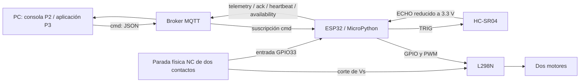
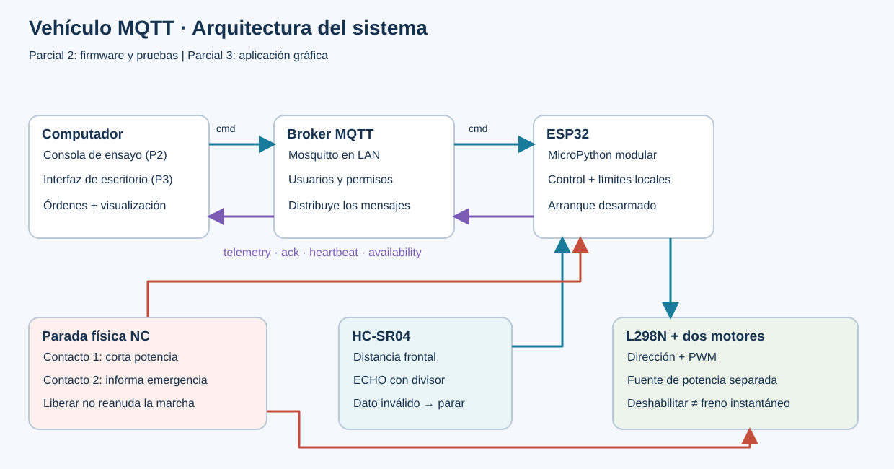
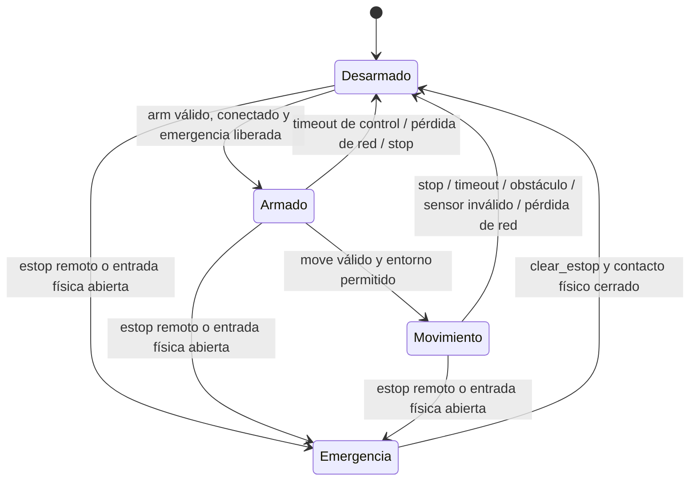

# 1. Alcance, objetivos y arquitectura

## Objetivo general

Desarrollar un firmware modular en MicroPython para controlar un vehículo diferencial con ESP32 mediante MQTT, adquirir distancia frontal y aplicar condiciones de detención ante obstáculos, pérdida de órdenes y emergencia.

## Objetivos específicos medibles

| Objetivo | Meta y evidencia |
|---|---|
| Adquirir distancia | Una adquisición cada 100 ms; publicar a 2 Hz distancia o `null` con estado de validez; contrastar 10, 20, 50 y 100 cm con regla |
| Controlar actuadores | Demostrar avance, retroceso, giro izquierdo/derecho y detención; PWM de 0 a 100 % con límite inicial de 60 % |
| Intercambiar datos | Recibir JSON válido por MQTT y publicar telemetría, confirmaciones, disponibilidad y heartbeat |
| Evitar marcha sin órdenes actuales | Invalidar la autorización de marcha a los 600 ms sin un nuevo comando de movimiento; verificar latencia real |
| Gestionar fallos | Reconectar con espera creciente hasta 10 s, siempre detenido; exigir nuevo armado tras reconexión |
| Proteger la operación | Parar y bloquear ante emergencia; no reanudar automáticamente al retirar un obstáculo o restaurar la red |
| Documentar desarrollo | Módulos, README, evidencias, historial real de commits y enlace Wokwi si se usa como evidencia final |

Las cifras de tiempo son parámetros de diseño, no mediciones ya obtenidas. El ciclo contiene una medición ultrasónica acotada y operaciones de red no bloqueantes durante la marcha. El corte físico de alimentación de motores es independiente del programa.

## Flujo de datos

## Responsabilidad de los módulos

| Módulo | Responsabilidad |
|---|---|
| `config.py` | Parámetros comunes y valores seguros por defecto |
| `config_local.py` | Credenciales privadas y ajustes del montaje; excluido de Git |
| `motor.py` | Dos puentes, PWM y paso por salida deshabilitada al cambiar sentido |
| `ultrasonic.py` | Disparo de 10 µs, lectura acotada y detección de medida inválida |
| `control.py` | Máquina de estados, validación estricta, secuencias, sesión y límites temporales |
| `mqtt_wire.py` | Subconjunto MQTT 3.1.1 QoS 0 con búferes y tiempos limitados |
| `wifi.py` | Conexión Wi-Fi mientras los motores permanecen apagados |
| `app.py` | Coordina lectura, decisiones, comunicación, reconexión y watchdog |
| `main.py` / `boot.py` | Punto de entrada y estado eléctrico de arranque |

## Máquina de estados

La reconexión no arma. El heartbeat de la aplicación mantiene su presencia, pero **no prolonga un movimiento**: cada movimiento exige renovación cada 200 ms. El sensor frontal se usa como autorización para cualquier movimiento de esta versión, incluidos giros y retroceso. Es una decisión conservadora: un obstáculo frontal obliga a retirar el vehículo manualmente. No existe detección de obstáculos traseros o laterales.

## Plan de trabajo del estudiante

1. Revisar el montaje y confirmar modelos y corrientes.
2. Comprobar alimentación y sensor por separado.
3. Verificar un motor y luego ambos con ruedas elevadas.
4. Configurar red y demostrar mensajes de estado.
5. Probar el control y todos los modos de parada.
6. Registrar resultados, fallos, correcciones y commits por cada etapa real.
7. Presentar demostración y conservar el contrato para la aplicación del Parcial 3.
