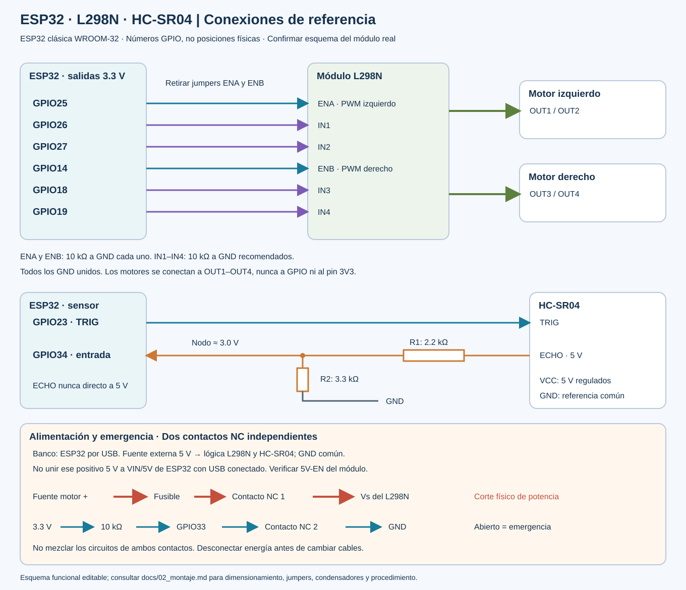

# 2. Materiales, pinout y montaje seguro

## 2.1 Supuestos que deben verificarse

Se diseña para una **ESP32 DevKit con ESP32-WROOM-32 clásica**, dos motores DC con reductora y módulo comercial L298N con diodos de recirculación y disipador. Confirmar la serigrafía y el esquema de la placa adquirida. Los números son **GPIO**, no posiciones físicas del conector. No trasladar este pinout a una C3/S3 ni a un módulo WROOM desnudo.

## 2.2 Lista de materiales

| Cantidad | Elemento | Selección y función |
|---|---|---|
| 1 | ESP32 DevKit WROOM-32 y cable USB de datos | Alimentación USB y programación inicial |
| 1 | L298N con disipador y diodos | Dos canales; verificar esquema, polaridad y corriente |
| 2 | Motores DC con reductora | Anotar tensión nominal y corriente de bloqueo de cada motor |
| 1 | Chasis, dos ruedas y rueda libre | Asegurar motores y separar cables del giro |
| 1 | HC-SR04 | 5 V; ECHO no se conecta directamente a ESP32 |
| 1 + 1 | Resistencias 2.2 kΩ y 3.3 kΩ, 1 % | Divisor de ECHO a aproximadamente 3.0 V |
| 2 | Resistencias 10 kΩ | ENA y ENB a GND; arranque deshabilitado |
| 4 | Resistencias 10 kΩ recomendadas | IN1–IN4 a GND para estados definidos |
| 1 | Resistencia 10 kΩ | GPIO33 a 3.3 V; contacto NC a GND |
| 1 | Parada de emergencia con dos contactos NC independientes | Un contacto corta Vs; el otro informa a GPIO33 |
| 1 | Fusible y portafusible | Calibre según corriente medida, arranque y capacidad del cable |
| 1 | Fuente de motores regulada o batería protegida | Tensión y corriente determinadas por motores y pérdidas |
| 1 | Fuente regulada de 5 V para lógica | Capacidad y polaridad verificadas antes de conectar |
| 1 | Condensador 470–1000 µF de tensión adecuada | Cerca de Vs/GND del L298N, respetando polaridad |
| 2 | Condensadores cerámicos 100 nF | Uno entre terminales de cada motor, cerca de sus bornes |
| Varios | Cable, borneras, multímetro y soporte de pruebas | El recorrido de potencia no debe usar protoboard ni cables finos |

No se fija un precio ni un fusible universal porque faltan los modelos reales. No seleccionar fuente a partir de la corriente en vacío solamente. El interruptor debe soportar **corriente continua** e irrupción de los motores; si no, usar un dispositivo de corte adecuado controlado por él.

## 2.3 Pinout obligatorio

| ESP32 | Destino | Tipo y condición |
|---|---|---|
| GPIO25 | L298N ENA | PWM motor izquierdo; retirar jumper ENA; 10 kΩ a GND |
| GPIO26 | L298N IN1 | Dirección izquierda |
| GPIO27 | L298N IN2 | Dirección izquierda |
| GPIO14 | L298N ENB | PWM motor derecho; retirar jumper ENB; 10 kΩ a GND |
| GPIO18 | L298N IN3 | Dirección derecha |
| GPIO19 | L298N IN4 | Dirección derecha |
| GPIO23 | HC-SR04 TRIG | Pulso de salida 3.3 V; verificar aceptación del módulo real |
| GPIO34 | Nodo del divisor ECHO | Solo entrada; sin pull-up interno disponible |
| GPIO33 | Contacto auxiliar NC a GND | Pull-up externo de 10 kΩ a 3.3 V; abierto = emergencia |
| GND | GND L298N, sensor y fuentes | Referencia común; recorrido de corriente de motor separado |
| — | L298N OUT1/OUT2 | Terminales del motor izquierdo |
| — | L298N OUT3/OUT4 | Terminales del motor derecho |

Los pines de arranque GPIO0/2/5/12/15, la memoria GPIO6–11 y la UART USB GPIO1/3 se dejan libres. GPIO34 es apto como entrada y no tiene resistencias internas; el divisor también establece su nivel bajo. [Referencia de GPIO de Espressif](https://docs.espressif.com/projects/esp-idf/en/stable/esp32/api-reference/peripherals/gpio.html).

## 2.4 Divisor para ECHO

```text
HC-SR04 ECHO (5 V) ── R1 2.2 kΩ ──┬── GPIO34
                                 │
                              R2 3.3 kΩ
                                 │
                                GND
```

`V_GPIO = V_ECHO × R2 / (R1 + R2) = 5 × 3.3 / 5.5 = 3.0 V`.

A 5.25 V y con resistencias de 1 % en el peor sentido, el nodo es aproximadamente 3.18 V. Confirmar el valor de ambas resistencias y medir antes de conectar a GPIO34; un multímetro puede no capturar el pico de pulsos cortos, por lo que se recomienda osciloscopio para ECHO real. No aceptar 5 V en un GPIO: las características eléctricas del ESP32 corresponden a lógica de 3.3 V. [Hoja de datos ESP32](https://www.espressif.com/sites/default/files/documentation/esp32_datasheet_en.pdf).

TRIG de 3.3 V suele ser reconocido por módulos HC-SR04 TTL; si el módulo concreto no lo reconoce, incorporar un traductor unidireccional compatible, por ejemplo una puerta de familia AHCT alimentada a 5 V, según su ficha. No elevar la salida ESP32 a 5 V mediante una resistencia pull-up.

## 2.5 Alimentación: elegir una sola ruta por placa

**Montaje de banco recomendado:**

1. ESP32 alimentada por USB del computador.
2. Fuente regulada independiente de 5 V alimenta HC-SR04 y la lógica del L298N.
3. Fuente de motores alimenta únicamente `Vs` (a veces rotulado `12V`) del L298N, pasando por fusible y contacto NC de potencia.
4. Unir todos los GND en una referencia común. El retorno de motores va directo a la fuente, evitando circular por la ESP32 o la protoboard.
5. No unir el positivo de esa fuente de 5 V al pin 5V/VIN de la ESP32 mientras esta recibe USB.

**Módulo L298N:** retirar los jumpers ENA/ENB para PWM. El jumper llamado habitualmente `5V-EN` corresponde a su regulador y es diferente. Para el esquema de lógica externa de 5 V, retirarlo **solo después de confirmar que el borne 5V pasa a ser entrada en ese modelo**. Algunas placas difieren: consultar el esquema o comprobar continuidad sin energía. Nunca conectar dos reguladores enfrentados.

**Montaje autónomo:** una batería protegida puede alimentar Vs y un convertidor de 5 V; conectar este último a una entrada documentada de la placa ESP32, sin USB simultáneo salvo que el fabricante garantice aislamiento. No se proporciona un conexionado universal de VIN porque las DevKit comerciales difieren. Primero completar la validación de banco.

## 2.6 Compatibilidad y pérdidas del L298N

El L298 acepta un nivel alto desde 2.3 V, por lo que una señal ESP32 de 3.3 V puede controlar sus entradas. Necesita alimentación lógica apropiada de 5 V. Tiene una caída importante en sus transistores: la tensión efectiva del motor resulta menor que Vs y depende de la corriente. Las especificaciones de corriente del integrado no equivalen a capacidad continua garantizada del módulo. [Ficha L298, tablas eléctricas](https://www.st.com/resource/en/datasheet/l298.pdf).

No compensar la caída aplicando una tensión arbitrariamente alta: durante PWM el motor recibe pulsos de tensión, y la caída no es constante. Para motores nominales de 6 V, comenzar con fuente limitada de hasta 6 V para el ensayo y aceptar la pérdida de rendimiento; si no basta, revisar el dimensionamiento o usar otro puente eficiente. Medir corriente con instrumento en **serie**, nunca cortocircuitar la fuente poniendo un amperímetro entre sus bornes.

Calcular la disipación a partir de la corriente y caída observadas. Como ejemplo conceptual, 1 A con caída de 2 V representa 2 W por canal. Si aparecen reinicios, calentamiento excesivo o caída fuerte de Vs, detener y revisar fuente, cableado y motor. Un fusible protege principalmente cableado y cortocircuitos; no garantiza salvar el puente frente a toda sobrecarga.

## 2.7 Parada física

```text
Fuente motor + ── fusible ── contacto NC de potencia ── Vs L298N
3.3 V ── 10 kΩ ── GPIO33 ── contacto NC auxiliar ── GND
```

Los contactos están mecánicamente vinculados y eléctricamente separados. Al pulsar se abren ambos: se retira energía de los motores y GPIO33 pasa a alto. **No llevar tensión de motor al contacto conectado a GPIO33.** Un cable auxiliar cortado también produce emergencia. Al liberar el pulsador, el programa sigue bloqueado hasta `clear_estop` y después `arm`. La orden remota `estop` es una medida de software; no sustituye el corte físico.

La parada por EN bajo es una **deshabilitación con posible avance por inercia**, no una garantía de frenado instantáneo. El umbral de 20 cm debe ajustarse a velocidad, superficie y distancia de detención medida. El prototipo no es un sistema de seguridad certificado.

## 2.8 Secuencia de montaje y mediciones

1. Con todas las fuentes desconectadas, identificar placa, contactos, jumpers y polaridades. Dibujar el esquema real si difiere del propuesto.
2. Conectar GND y divisor; medir resistencias y descartar cortocircuito entre positivos y GND.
3. Alimentar la lógica sin motores y medir 5 V y 3.3 V. Apagar antes de cambiar cables.
4. Verificar el sensor y el nivel máximo de ECHO. Mostrar `distance_cm` y `sensor_ok`.
5. Conectar EN y dirección, comprobar que ENA/ENB permanecen bajos en arranque, reinicio y ausencia de programa.
6. Cablear corte físico de Vs y auxiliar; comprobar continuidad y apertura sin alimentación.
7. Conectar un motor, ruedas suspendidas y fuente limitada. Confirmar sentido a baja potencia; después probar el segundo.
8. Si un lado gira invertido, apagar e intercambiar sus terminales o ajustar `INVERT_LEFT/RIGHT`. No cambiar al azar la tabla de direcciones.
9. Medir consumo de arranque y marcha; registrar Vs bajo carga y temperatura del controlador con método apropiado.
10. Ejecutar pérdidas de conexión, timeout, emergencia y obstáculos antes de probar sobre el suelo.


