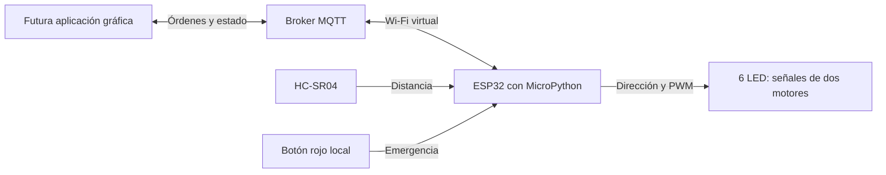

# Parcial 2 — Vehículo ESP32 preparado para control desde una aplicación

Firmware en MicroPython y montaje Wokwi enfocados a recibir órdenes de la futura interfaz gráfica mediante MQTT. El Parcial 2 incluye la ESP32, lectura del sensor, señales de motores, decisiones de parada y comunicación. La aplicación del Parcial 3 no está desarrollada; su contrato de mensajes queda definido en `CONTRATO_MQTT.md`.

## Arquitectura



La aplicación decidirá qué movimiento solicita el usuario; la ESP32 decide si puede ejecutarlo. El sensor y el botón rojo pueden detener las salidas independientemente de la aplicación.

## Qué cambia en el montaje

Se retiran los cuatro botones de dirección y el potenciómetro. La dirección y la potencia llegan por MQTT. Se conserva el botón rojo, ahora como parada de emergencia que queda bloqueada hasta un restablecimiento explícito.

| Componente | Cantidad | Función |
|---|---:|---|
| ESP32 DevKit V1 | 1 | Ejecutar MicroPython y conectarse al broker |
| HC-SR04 | 1 | Medir obstáculos |
| Pushbutton rojo | 1 | Emergencia local |
| LED azules | 4 | Señales IN1, IN2, IN3 e IN4 |
| LED verdes | 2 | Señales PWM ENA y ENB |
| Resistencias de 220 ohmios | 6 | Una por LED |

Son **15 componentes**, o 14 por agregar si la placa ya está presente. Hay además dos etiquetas de texto opcionales. No hace falta agregar un router, una batería o una pantalla.

Los LED representan las señales que recibiría un controlador de motores: no simulan un L298N ni el movimiento mecánico del carro. PWM es potencia solicitada, no velocidad medida.

## Conexiones exactas

| Terminal | Conexión en ESP32 |
|---|---|
| HC-SR04 VCC | VIN |
| HC-SR04 GND | GND |
| HC-SR04 TRIG | GPIO23 |
| HC-SR04 ECHO | GPIO34 |
| Botón rojo 1.l | GPIO13 |
| Botón rojo 2.l | GND |
| ENA, mediante resistencia de 220 ohmios | GPIO25 |
| IN1, mediante resistencia de 220 ohmios | GPIO26 |
| IN2, mediante resistencia de 220 ohmios | GPIO27 |
| ENB, mediante resistencia de 220 ohmios | GPIO14 |
| IN3, mediante resistencia de 220 ohmios | GPIO18 |
| IN4, mediante resistencia de 220 ohmios | GPIO19 |

Cada LED se conecta `GPIO -> resistencia -> A`; su terminal C va a GND. Todos comparten tierra. Los terminales 1.r y 2.r del botón quedan libres. El código usa `PULL_UP`: pulsado equivale a cero. El diagrama desactiva el rebote con `bounce: "0"`.

**Solo Wokwi:** ECHO directo es una simplificación de esta simulación digital; no copiar esa conexión directamente a una ESP32 física. El pulsador representa una parada por software, no un corte eléctrico de potencia.

## Archivos

| Archivo | Responsabilidad |
|---|---|
| `main.py` | Integra sensor, botón, MQTT y publicación periódica |
| `cliente_mqtt.py` | Clase ClienteMQTT con conectar, publicar, suscribir y recibirmensaje |
| `config.py` | Wi-Fi, broker, topics y tiempos |
| `control.py` | Validación de órdenes, sesiones y reglas de parada |
| `motores.py` | Dirección y PWM de las seis salidas |
| `sensor.py` | Medición del HC-SR04 |
| `red.py` | Función conectar(ssid, password), con plazo y atención a la parada local |
| `mqtt_wire.py` | Cliente MQTT 3.1.1 incluido; no requiere instalar umqtt |
| `clockutil.py` | Medición de intervalos, incluyendo desbordamiento del reloj |
| `diagram.json` | Componentes y conexiones |
| `CONTRATO_MQTT.md` | Topics, ejemplos JSON y comportamiento esperado de la futura app |
| `README.md` | Montaje, ejecución y validación |

## Relación con el ejemplo de clase

Se aprovecha la organización del ejemplo proporcionado: `red.py` para Wi-Fi, `ClienteMQTT` para comunicación y `main.py` para el comportamiento del sistema. En el programa principal aparecen los mismos métodos `conectar()`, `publicar()`, `suscribir()` y `recibirmensaje()`.

Se adapta el ejemplo de estas maneras:

- `red.conectar()` devuelve el objeto Wi-Fi para detectar desconexiones y limita la espera. Mientras conecta, atiende el botón rojo con las salidas detenidas.
- `suscribir()` registra la función antes de conectar. La conexión envía la suscripción al único topic de comandos `BASE/cmd`; `listo` indica su confirmación. Se vuelve a suscribir al reconectar.
- La función receptora tiene tres argumentos: `(topico, mensaje, retenido)`. Los dos primeros son bytes, como en el ejemplo. El tercero permite rechazar órdenes antiguas entregadas como retenidas.
- `publicar()` admite texto o bytes y una opción `retain`. Los comandos nunca se retienen.
- `recibirmensaje()` atiende la comunicación dentro del bucle que también lee el sensor y comprueba los tiempos de parada.
- Se añaden `cerrar()` y `listo` para tratar pérdidas de conexión.
- No se usa el chat de `sys.stdin` ni el parpadeo `Led(2)`: la función receptora valida órdenes del vehículo, y el programa publica su estado.

**Se reutiliza la estructura del ejemplo, no su importación directa de `umqtt.simple`.** Se conserva `mqtt_wire.py` como transporte interno. En la implementación oficial consultada, `check_msg()` pasa a lecturas bloqueantes al procesar un paquete; un paquete incompleto puede demorar el bucle de control. El transporte incluido conserva fragmentos y vuelve al bucle para seguir atendiendo las paradas. [Código oficial de umqtt.simple](https://raw.githubusercontent.com/micropython/micropython-lib/master/micropython/umqtt.simple/umqtt/simple.py).

El broker se configura en `config.py`; no se cambió automáticamente al del ejemplo. La ESP32 y la futura app deben usar el mismo broker y topics, con identificadores de cliente diferentes. Los topics de chat `Prueba/chat` y `Prueba/chat2` se sustituyen por los definidos en `CONTRATO_MQTT.md`.

## Ejecutar en Wokwi

1. Abrir un proyecto [ESP32 con MicroPython](https://wokwi.com/projects/new/micropython-esp32).
2. Cargar los nueve archivos `.py` y `diagram.json` en la raíz del proyecto, reemplazando los archivos de la versión anterior. `red.py` sustituye al anterior `wifi.py`. Los dos documentos Markdown son material de consulta.
3. Revisar `config.py`: Wi-Fi `Wokwi-GUEST`, contraseña vacía; broker `test.mosquitto.org`, puerto 1883, sin credenciales.
4. Mantener el mismo `TOPIC_BASE` en la ESP32 y el cliente MQTT. Cambiar su sufijo si se ejecutan copias independientes del proyecto.
5. Iniciar la simulación y dejar el sensor en 100 cm. El monitor serie debe indicar la conexión y mostrar telemetría JSON. Los LED permanecen apagados hasta recibir órdenes válidas.
6. Con un cliente MQTT de pruebas, suscribirse a `parcial2/vehiculo_7d49c2a1/#`, QoS 0. Seguir `CONTRATO_MQTT.md` para enviar `arm`, esperar confirmación y enviar `move`. No retener los comandos.
7. La futura aplicación usará exactamente los mismos mensajes. No hace falta modificar los pines al incorporarla.

Wokwi proporciona la red abierta Wokwi-GUEST. El gateway público permite conexiones salientes al broker de Internet; un broker del computador en localhost no es accesible como tal desde esa red virtual. Referencia: [Wi-Fi de Wokwi](https://docs.wokwi.com/guides/esp32-wifi).

El broker configurado es público, sin autenticación ni cifrado: usarlo solo para la demostración, sin datos privados. Puede reiniciarse o no estar disponible. Referencia: [servidor de pruebas Mosquitto](https://test.mosquitto.org/).

## Funcionamiento del firmware

- Arranque y reconexión: salidas apagadas; siempre se exige habilitar el control con `arm`.
- Movimiento: dirección remota y PWM entero de 1 a 100 %. La futura app repite `move` cada 250 ms mientras el usuario mantenga pulsado el control.
- Ausencia de nuevas órdenes de movimiento durante 800 ms: parada, aunque sigan llegando heartbeats.
- Control habilitado sin movimiento: `heartbeat` mantiene la habilitación; caduca después de 1500 ms sin órdenes válidas.
- Sensor: lectura aproximadamente cada 100 ms; distancia de 20 cm o menos, fallo de lectura o dato de más de 350 ms impiden la marcha en cualquier dirección.
- Botón rojo o `estop`: parada bloqueada; soltar el botón no reanuda. Se requiere `clear_estop`, luego una nueva habilitación y una nueva orden.
- Pérdida detectada de Wi-Fi o MQTT: parada y reconexión con esperas de 1, 2, 4, 8 y hasta 10 segundos. Las esperas de conexión ocurren con salidas apagadas.
- Las sesiones cambian al detener/deshabilitar; las órdenes de una sesión anterior se rechazan. La aplicación nunca debe reanudar por sí sola.
- Telemetría: cada 500 ms y tras comandos. Heartbeat de la ESP32: cada 1000 ms. El broker anuncia desconexión mediante el último testamento MQTT.

Los tiempos se comprueban en el bucle de ejecución y no constituyen garantías de tiempo real de un sistema físico. El cliente MQTT usa lectura/escritura no bloqueantes durante la marcha, límites de tamaño y plazos para tramas incompletas. La búsqueda DNS y el establecimiento de conexión pueden esperar, pero se hacen con motores detenidos.

## Relación con el enunciado del Parcial 2

| Solicitud | Implementación |
|---|---|
| MicroPython sobre ESP32 | Nueve módulos Python ejecutados desde `main.py` |
| Sensores | HC-SR04 y procesamiento de distancia |
| Entradas y salidas | Botón rojo, ECHO, TRIG y salidas digitales/PWM |
| Control de actuadores | Señales de dos motores representadas con LED |
| Procesamiento de información | Validación de órdenes y decisiones de parada |
| Funcionalidades acordes a la propuesta | Recepción y envío MQTT preparados para control remoto |
| Desarrollo progresivo | Evolución del control local hacia el control remoto; código modular |

La interfaz gráfica y su implementación pertenecen al Parcial 3. Aquí se deja lista únicamente la parte que necesita la ESP32 para comunicarse con ella.

## Pruebas de demostración pendientes en Wokwi

| Acción | Resultado esperado |
|---|---|
| Arrancar sin cliente MQTT | Todas las salidas apagadas |
| Recibir `move` sin `arm` previo | Rechazo y salidas apagadas |
| Habilitar y avanzar con sensor a 100 cm | IN1 e IN3 encendidos; ENA y ENB con PWM |
| Cambiar `speed` de 30 a 70 durante órdenes renovadas | Mayor brillo en ENA y ENB |
| Soltar control y enviar `stop` | Todas las salidas apagadas |
| Dejar de renovar `move` | Parada al vencer 800 ms |
| Cambiar sensor a 10 cm | Parada y cambio de sesión |
| Volver a 100 cm | Permanece detenido |
| Pulsar y soltar botón rojo | Emergencia permanece bloqueada |
| Restaurar conexión después de una pérdida | Permanece detenido; requiere nuevas órdenes |

## Validación realizada

Pruebas locales de lógica, adaptadores con periféricos dobles y transporte MQTT: **46 pruebas aprobadas**. Cubren las cuatro direcciones, PWM, sensor, mensajes inválidos y repetidos, plazos de parada, emergencias, reconexión lógica, fragmentación TCP y reloj con desbordamiento. Incluyen la integración de `ClienteMQTT` con comandos y publicación, y la función `red.conectar()` con conexión disponible o ausente. También se comprobaron la sintaxis de los nueve módulos y la estructura de las conexiones del diagrama. No equivalen a ejecutar MicroPython dentro de Wokwi.

El 2 de noviembre de 2026 se intentó además una prueba contra `test.mosquitto.org:1883` desde el computador. La conexión TCP agotó el plazo antes de intercambiar mensajes; esa prueba **no se completó** y no demuestra un fallo del firmware ni confirma que el broker sea accesible desde Wokwi. La comunicación con un broker real sigue pendiente de verificación.

Desde la carpeta raíz de trabajo pueden repetirse con:

```powershell
.\.venv\Scripts\python.exe -m unittest discover -s verificacion_wokwi -v
```

La carpeta `verificacion_wokwi` está separada del paquete de firmware; esas pruebas se ejecutan en el computador. La simulación completa en Wokwi sigue pendiente por el bloqueo de permisos del navegador de esta sesión. No se realizaron pruebas físicas ni se desarrolló una aplicación gráfica.

**Enlace Wokwi:** pendiente de guardar y comprobar.
